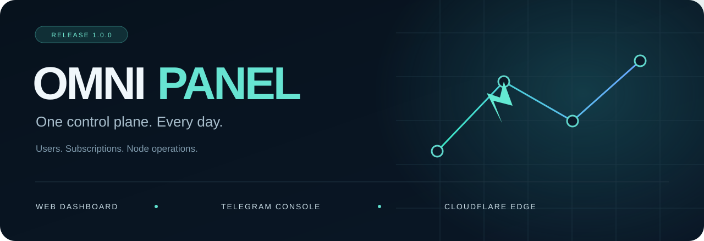

<div align="center">



# Omni Panel

**Users, profiles and connection paths. One control plane.**

A Cloudflare Workers dashboard and Telegram console, with WARP Studio and MASQUE Studio.

[Latest release](https://github.com/imgutss/omni/releases/latest) · [Quick guide](docs/GUIDE.md) · [Deploy](docs/DEPLOY.md) · [فارسی](README.md)

</div>

## The main tools

**Profiles** — Select a user and ingress path, adjust address and port, then export links, QR codes or a supported client format. VLESS/Trojan, IPv4/IPv6 pools and Host/SNI/path settings live together.

**Outbound & location** — Choose how traffic leaves the panel: direct access, an owned exit or a prepared relay. Ingress and egress are separate; selecting a country label does not by itself change the public exit IP.

**WARP Studio** — Manage the panel's WARP account and WireGuard configuration. Select endpoints, DNS and network options, then test the result on the actual client network.

**MASQUE Studio** — Generate client-specific profiles with a separate MASQUE key. Choose H2/H3, endpoint, port and DNS; additional controls depend on the client. Start with an official endpoint and port 443.

[Short usage guide →](docs/GUIDE.md)

## Around the dashboard

| Section | Purpose |
|---|---|
| Dashboard | User, usage and service overview |
| Users | Accounts, quota, expiry, renewal and subscriptions |
| Relays | Optional infrastructure, domains and owned provider resources |
| Telegram proxy | Supported Telegram proxy and routing options |
| Causal Mesh | Multi-node path configuration and diagnostics; validate the actual path |
| Scanner | Candidate discovery and ranking, not an end-to-end tunnel guarantee |
| DNS / diagnostics | Resolver configuration, connection checks and error investigation |
| Settings / sessions | Panel policies, backups, security and login-session management |

## Get started

1. Send `/start` to the [Omni bot](https://t.me/OmniAiGateBot), then create or select your panel using accounts you are authorized to manage.
2. Create a user and set quota, validity and the desired connection path.
3. Export a profile or subscription and test it in a compatible client.

[**Omni App 1.0.0**](https://github.com/imgutss/Omni-App/releases/tag/v1.0.0) is the companion Android client. Format support depends on its core; neither project is exclusive to the other. App protocol support does not turn this Worker into a server for every app protocol.

## Build

```bash
# Node.js 22+
npm ci
npm run build
npm test
```

Artifacts are generated in `panel/build/`. `panel/src/` contains the backend/dashboard, `tools/` handles releases, and `relay/` contains the optional Railway relay. The root Dockerfile runs the relay, not the Worker panel.

[Deployment](docs/DEPLOY.md) · [Architecture](docs/ARCHITECTURE.md) · [Release maintenance](docs/MAINTAINER.md)

Providers have independent quotas and terms. Free operation, speed and universal connectivity are not guaranteed. Treat profiles, studio keys and SQL exports as secrets.

[Security](SECURITY.md) · [Third-party rights](THIRD_PARTY_NOTICES.md)
