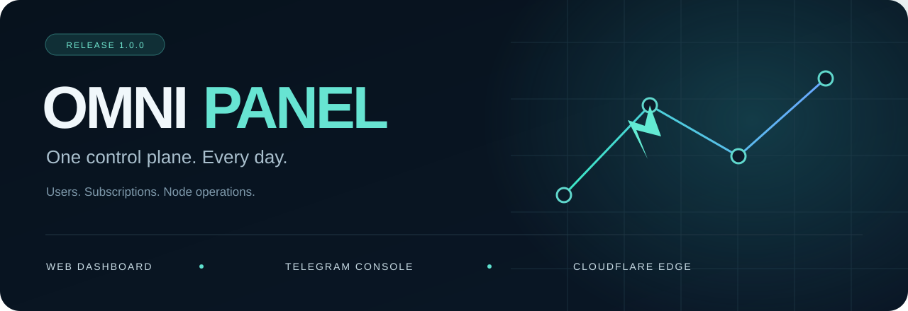

<div align="center">



# Omni Panel

**کاربران، کانفیگ‌ها و مسیر اتصال؛ همه در یک پنل.**

پنل وب و کنسول تلگرام روی Cloudflare Workers، همراه با WARP Studio و MASQUE Studio.

[دانلود نسخهٔ ۱](https://github.com/imgutss/omni/releases/latest) · [شروع کار](docs/GUIDE.fa.md) · [نصب](docs/DEPLOY.fa.md) · [English](README.en.md)

</div>

## چهار بخش، چهار کاربرد روشن

### کانفیگ‌ها
کاربر و مسیر ورودی را انتخاب کنید، آدرس و پورت را تنظیم کنید و خروجی را به‌صورت لینک، QR یا قالب سازگار دریافت کنید. VLESS و Trojan، پک‌های IPv4/IPv6 و تنظیمات Host، SNI و مسیر در یک جا هستند.

### اوت‌باند و لوکیشن
مشخص کنید ترافیک بعد از رسیدن به پنل از کجا خارج شود: مسیر مستقیم، خروجی اختصاصی یا رلهٔ آماده. ورودی کانفیگ و خروجی اینترنت از هم جدا هستند؛ انتخاب نام یک کشور به‌تنهایی IP خروجی را تغییر نمی‌دهد.

### WARP Studio
حساب WARP پنل و تنظیمات WireGuard را مدیریت کنید؛ اندپوینت، DNS و گزینه‌های شبکه را انتخاب کنید و خروجی مناسب بگیرید. بررسی اندپوینت روی شبکهٔ خودتان، از تکیه به یک عدد پینگ مهم‌تر است.

### MASQUE Studio
با کلید مستقل MASQUE، خروجی مناسب کلاینت بسازید. H2 یا H3، اندپوینت، پورت و DNS قابل‌انتخاب‌اند؛ گزینه‌های تکمیلی هم با نوع کلاینت تغییر می‌کنند. برای شروع، اندپوینت رسمی و پورت 443 را امتحان کنید.

[راهنمای کوتاه این چهار بخش ←](docs/GUIDE.fa.md)

## بقیهٔ پنل، در یک نگاه

| بخش | برای چه کاری؟ |
|---|---|
| **داشبورد** | دید کلی کاربران، مصرف و وضعیت پنل |
| **کاربران** | ساخت کاربر، حجم و اعتبار، تمدید، غیرفعال‌سازی و اشتراک شخصی |
| **اینترنت ملی و رله‌ها** | اتصال رله‌های اختیاری، دامنه و زیرساخت متعلق به خودتان |
| **پروکسی تلگرام** | تنظیم مسیر و کانفیگ‌های مربوط به تلگرام، مطابق حالت پشتیبانی‌شده |
| **Causal Mesh** | مدیریت و بررسی مسیرهای چندگرهی در قابلیت Mesh؛ نیازمند آزمون همان مسیر |
| **اسکنر** | یافتن و مرتب‌کردن نامزدهای اتصال؛ پاسخ HTTPS با تونل موفق یکی نیست |
| **DNS** | تنظیم و بررسی DNS در بخش‌های مربوط |
| **عیب‌یابی** | مشاهدهٔ خطاها و بررسی لایه‌های اتصال |
| **تنظیمات و نشست‌ها** | نام و سیاست‌های پنل، امنیت، پشتیبان و مدیریت نشست‌های ورود |

## شروع ساده

۱. در [ربات Omni](https://t.me/OmniAiGateBot) دستور `/start` را بفرستید و پنل خودتان را بسازید یا انتخاب کنید. فقط حساب و منابعی را متصل کنید که اجازهٔ مدیریتشان را دارید.

۲. در پنل یک کاربر بسازید؛ حجم، مدت اعتبار و مسیر دلخواه را تنظیم کنید.

۳. از **کانفیگ‌ها** یا یکی از استودیوها خروجی بگیرید و در کلاینت سازگار امتحان کنید.

[**Omni App 1.0.0**](https://github.com/imgutss/Omni-App/releases/tag/v1.0.0) کلاینت اندروید همراه پروژه است. پشتیبانی هر قالب به هستهٔ کلاینت بستگی دارد؛ پنل و اپ به یکدیگر محدود نیستند.

## نصب و توسعه

```bash
# Node.js 22+
npm ci
npm run build
npm test
```

خروجی آماده در `panel/build/` ساخته می‌شود. سورس پنل در `panel/src/`، ابزار انتشار در `tools/` و رلهٔ اختیاری Railway در `relay/` است. Dockerfile ریشه فقط رله را اجرا می‌کند، نه پنل Cloudflare.

[نصب و پشتیبان‌گیری](docs/DEPLOY.fa.md) · [معماری](docs/ARCHITECTURE.fa.md) · [انتشار نسخهٔ بعدی](docs/MAINTAINER.fa.md)

> سرویس‌ها سهمیه و شرایط مستقل دارند؛ رایگان‌بودن، سرعت یا اتصال روی تمام شبکه‌ها تضمین نمی‌شود. فایل کانفیگ، کلید استودیوها و خروجی SQL را محرمانه نگه دارید.

[امنیت](SECURITY.md) · [حقوق و وابستگی‌ها](THIRD_PARTY_NOTICES.md)

<div align="center">Omni · <a href="https://github.com/imgutss">imgutss</a></div>
