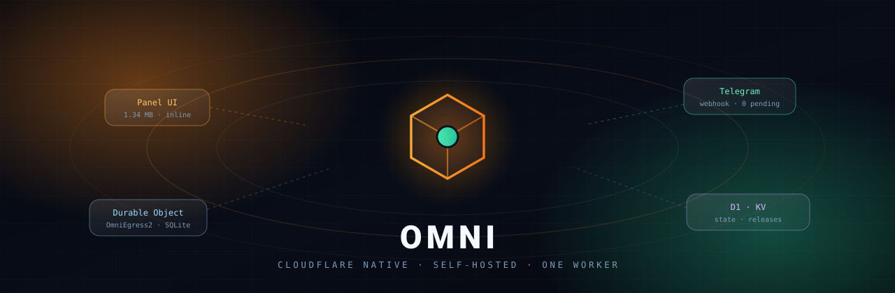
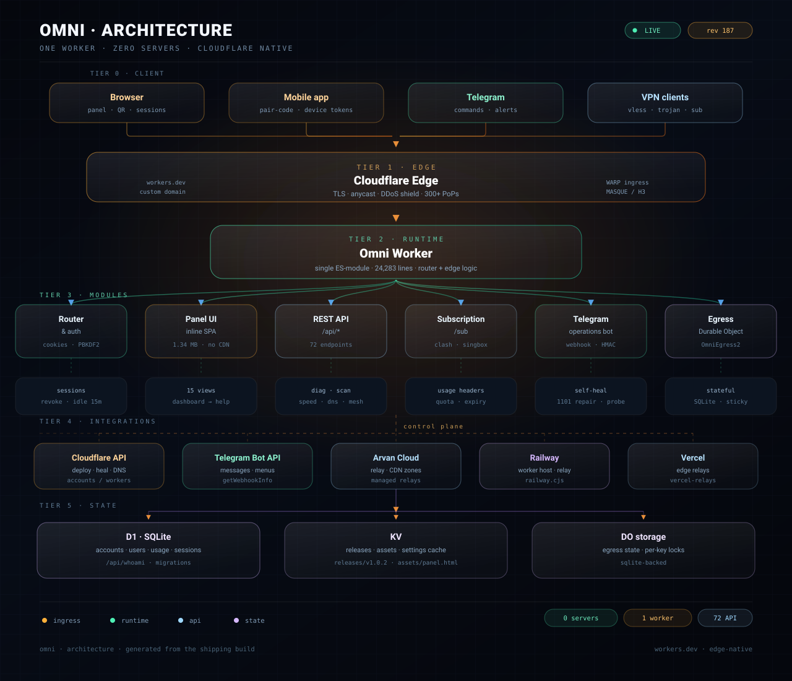
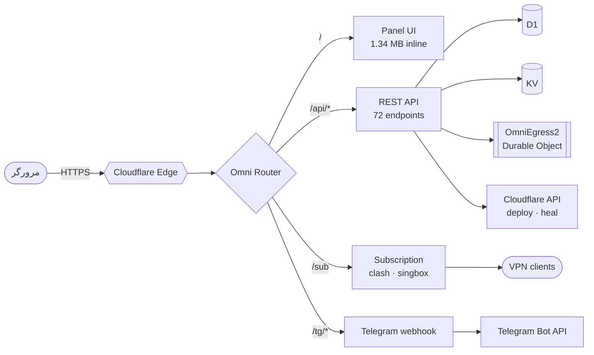
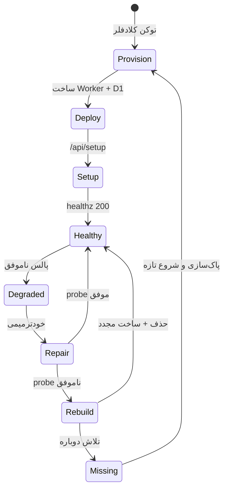

<div align="center">



<h1 align="center">Omni&nbsp;Panel</h1>

<p><b>یک Worker. صفر سرور. کل کنترل روی ابرِ خودت.</b><br/>
<span>پنل وب + کنسول تلگرام روی Cloudflare Workers — با WARP، MASQUE، رله و مسیر هوشمند.</span></p>

<p>
<a href="https://github.com/imgutss/omni/releases/latest"></a>
<a href="https://github.com/imgutss/omni/stargazers"></a>
<a href="https://github.com/imgutss/omni/commits/main"></a>


</p>

<p>
<a href="#-معماری">معماری</a> ·
<a href="#-نقشهٔ-قابلیت‌ها">قابلیت‌ها</a> ·
<a href="#-نصب">نصب</a> ·
<a href="#-ربات-تلگرام">ربات</a> ·
<a href="#-مرجع-api">API</a> ·
<a href="docs/GUIDE.fa.md">راهنما</a> ·
<a href="README.en.md">English</a>
</p>

</div>

<br/>

<div align="center">

```
 ┌──────────────────────────────────────────────────────────────────────────────┐
 │  ONE  WORKER  →  24,283 lines  →  72 endpoints  →  15 views  →  ∞ panels     │
 └──────────────────────────────────────────────────────────────────────────────┘
```

</div>

<table align="center">
<tr>
<td align="center" width="25%"><h3>⚡ <code>0</code></h3><sub>سرور</sub></td>
<td align="center" width="25%"><h3>🛡️ <code>300+</code></h3><sub>PoP لبه</sub></td>
<td align="center" width="25%"><h3>🧩 <code>15</code></h3><sub>نمای پنل</sub></td>
<td align="center" width="25%"><h3>🔌 <code>72</code></h3><sub>endpoint</sub></td>
</tr>
</table>

---

## 🧭 معماری

<div align="center">

</div>

<br/>

<details open>
<summary><b>دیاگرام شاخه‌ای لایه‌ها — متن خوانا (ASCII)</b></summary>

<br/>

```
Omni
│
├── TIER 0 · CLIENT  ──────────────────────────────── ورودی‌های کاربر
│   ├── Browser ......... پنل وب، QR، مدیریت سشن‌ها
│   ├── Mobile app ...... pair-code، ابزارهای دستگاه
│   ├── Telegram ........ دستورات، منوها، هشدارها
│   └── VPN clients ..... VLESS، Trojan، سابسکرایب
│
├── TIER 1 · EDGE  ────────────────────────────────── کلادفلر
│   ├── workers.dev .... دامنهٔ پیش‌فرض
│   ├── Custom domain .. دامنهٔ اختصاصی
│   ├── TLS / Anycast .. تمرکز و پخش بار
│   └── WARP / MASQUE .. مسیر ورود اختصاصی
│
├── TIER 2 · RUNTIME  ─────────────────────────────── هستهٔ اجرا
│   └── Omni Worker ..... یک ES-module، بدون وابستگی خارجی
│       ├── Router ...... مسیر‌یابی + نشست + کوکی
│       ├── Panel UI .... SPA درون‌خطی (بدون CDN)
│       ├── REST API .... ۷۲ endpoint
│       ├── Subscription  /sub با هدرهای مصرف
│       ├── Telegram .... webhook امضاشده
│       └── Egress ...... Durable Object (OmniEgress2)
│
├── TIER 3 · MODULES  ─────────────────────────────── بخش‌های پنل
│   ├── dashboard ....... نمای کلی و شمارنده‌ها
│   ├── configs ......... کانفیگ‌ساز (VLESS/Trojan)
│   ├── users ........... کاربر، کوتا، انقضا، دستگاه
│   ├── outbound ........ خروجی مستقیم / رله / WARP
│   ├── masque .......... استودیوی MASQUE / H3
│   ├── wireguard_game .. وایرگارد و امنزیا
│   ├── mesh ............ آزمایشگاه مسیر و رقابت لبه
│   ├── scanner ......... اسکن و امتیازدهی IP
│   ├── dns ............. DNS، ECH، تشخیص
│   ├── diag ............ پینگ، سرعت، لاگ، نگهداری
│   ├── sessions ........ دستگاه‌ها و ابطال نشست
│   ├── tg_proxy ........ پل تلگرام
│   ├── national_net .... رلهٔ WebSocket
│   ├── settings ........ تنظیمات کامل پنل
│   └── help ............ راهنمای درون‌پنلی
│
├── TIER 4 · INTEGRATIONS  ────────────────────────── سرویس‌های بیرونی
│   ├── Cloudflare API .. دیپلوی، ترمیم، DNS
│   ├── Telegram Bot API  پیام، منو، health
│   ├── Arvan Cloud ..... رله و زون CDN
│   ├── Railway ......... میزبان ورکر/رله
│   └── Vercel .......... رله‌های لبه
│
└── TIER 5 · STATE  ───────────────────────────────── ذخیره‌سازی
    ├── D1 · SQLite ..... حساب، کاربر، مصرف، نشست
    ├── KV .............. release، asset، کش تنظیمات
    └── DO storage ...... وضعیت Egress، قفل‌های کلید
```

</details>

<br/>

### جریان یک درخواست



<br/>

### چرخهٔ حیات یک پنل



<br/>

---

## 🎛️ قابلیت‌ها

<table>
<tr>
<td align="center" width="33%">

**🔐 دسترسی**

`PBKDF2` · `نشست ۱۵ دقیقه`
`ثبت‌نام قابل خاموش‌کردن`
`کد بازیابی` · `ابطال نشست`

</td>
<td align="center" width="33%">

**👥 کاربران**

`کوتا` · `انقضا` · `محدودیت دستگاه`
`فعال‌سازی در اولین اتصال`
`برچسب` · `فرگمنت` · `عملیات گروهی`

</td>
<td align="center" width="33%">

**🔗 کانفیگ**

`VLESS` · `Trojan` · `SNI دلخواه`
`استخر IPv4/IPv6` · `QR`
`سابسکرایب با هدر مصرف`

</td>
</tr>
<tr>
<td align="center" width="33%">

**🌐 مسیر خروج**

`مستقیم` · `رله` · `خروجی اختصاصی`
`WARP` · `MASQUE (H3)`
`آروان` · `Railway` · `Vercel`

</td>
<td align="center" width="33%">

**🔬 تشخیص**

`پینگ` · `سرعت` · `DNS` · `ECH`
`اسکن IP` · `آزمایشگاه مسیر`
`لاگ زنده`

</td>
<td align="center" width="33%">

**🛠️ نگهداری**

`/healthz` بدون احراز
`خودترمیمی ۳ مرحله‌ای`
`بکاپ و بازیابی`

</td>
</tr>
</table>

<sub align="center">🤖 تلگرام: مدیریت کامل از چت · هشدار خرابی · چندحسابی &nbsp;·&nbsp; 📱 اپ: اتصال با pair-code</sub>

<br/>

## 🚀 نصب

### پیش‌نیاز

| لازم | چرا |
|---|---|
| حساب Cloudflare | Workers، D1، KV |
| API Token با دسترسی Workers + D1 | دیپلوی و ساخت دیتابیس |
| ربات تلگرام (اختیاری) | فقط اگر کنسول تلگرام را می‌خواهی |

### گام‌به‌گام

```bash
# ۱ · کلون
git clone https://github.com/imgutss/omni.git && cd omni

# ۲ · نصب
npm install

# ۳ · انتشار
npm run release          # ساخت باندل نهایی در panel/build
```

سپس از داخل ربات یا پنل، توکن کلادفلر را بده و «ساخت خودکار روی حساب من» را بزن. پنل روی `workers.dev` بالا می‌آید و `/api/setup` اولین ادمین را می‌سازد.

<details>
<summary><b>دستی با wrangler</b></summary>

```bash
cp wrangler.toml wrangler.local.toml   # شناسه‌های خودت را بگذار
npx wrangler deploy --config wrangler.local.toml
```

سپس یک‌بار `/api/setup` را صدا بزن تا جدول‌ها و ادمین ساخته شوند.

</details>

### بررسی سلامت

```bash
curl -s https://<your-worker>/healthz          # → 200
curl -s https://<your-worker>/api/whoami | jq  # → installed:true
```

<br/>

---

## 🤖 ربات تلگرام

<div align="center">

```text
 /start        منوی اصلی            /panels      فهرست پنل‌ها
 /new          ساخت پنل تازه        /repair      ترمیم پنل خراب
 /status       وضعیت زنده           /backup      بکاپ دیتابیس
 /users        کاربران              /help        راهنما
```

</div>

- وبهوک با `secret_token` امضا می‌شود؛ درخواست بدون امضا رد می‌شود.
- `getWebhookInfo` باید `pending: 0` و بدون خطا باشد.
- ترمیم سه‌مرحله‌ای است: بازنویسی → probe → در صورت شکست، حذف و ساخت دوباره با همان نام.

> [!NOTE]
> خطای **1101** روی کلادفلر یعنی خود سرویس مرده، نه کد. بازنویسی درجا هیچ‌وقت کافی نیست؛ باید اسکریپت حذف و با همان نام از نو ساخته شود. Omni این کار را خودکار انجام می‌دهد.

<br/>

---

## 🔌 مرجع API

<div align="center">

| گروه | نمونه | کار |
|---|---|---|
| هویت | `/api/whoami` `/api/login` `/api/setup` | ورود و وضعیت |
| کاربران | `/api/users` `/api/users/bulk` | مدیریت کاربر |
| کانفیگ | `/api/fragments` `/api/countries` `/api/ech-config` | ساخت خروجی |
| مسیر | `/api/mesh/*` `/api/clean/*` | آزمایش و بهینه‌سازی |
| تشخیص | `/api/diag/*` `/api/scan/*` | پینگ، سرعت، اسکن |
| امنیت | `/api/sessions` `/api/vault/*` | نشست و گاوصندوق |
| تلگرام | `/api/bot/status` `/api/bot/notify` | اتصال ربات |
| سرویس | `/api/healthz` `/api/version` | پایش |

</div>

<details>
<summary><b>قرارداد پاسخ</b></summary>

```json
{
  "ok": true,
  "v": "1.0.7",
  "rev": 187,
  "egress": 1
}
```

خطاها همیشه با `ok:false` و `code` ماشین‌خوان برمی‌گردند:

```json
{ "ok": false, "code": "bad_credentials", "error": "نام کاربری اشتباه است" }
```

</details>

<br/>

---

## 🧱 ساختار مخزن

```text
omni/
├── panel/
│   ├── src/
│   │   ├── worker.mjs        ← هستهٔ ES-module (ورکر کامل)
│   │   └── panel.html        ← رابط کاربری درون‌خطی
│   ├── test/                 ← release · workerd · browser
│   ├── build.mjs             ← ساخت باندل نهایی
│   └── release.json          ← نسخه و متادیتا
├── docs/
│   ├── assets/               ← hero و دیاگرام معماری (SVG)
│   ├── GUIDE.fa.md           ← راهنمای کاربر
│   ├── DEPLOY.fa.md          ← نصب
│   └── ARCHITECTURE.fa.md    ← معماری
├── relay/railway.cjs         ← رلهٔ Railway
├── tools/                    ← دیپلوی و بسته‌بندی
├── test/managed.mjs          ← تست یکپارچه
└── wrangler.toml
```

<br/>

---

## 🧪 تست

```bash
npm test            # release + workerd + browser
npm run test:rel    # فقط تست انتشار
```

<div align="center">

```
 ✓ release    ✓ workerd    ✓ browser
```

</div>

<br/>

---

## 🛡️ امنیت

- توکن‌ها هرگز در مخزن ذخیره نمی‌شوند؛ همه از طریق Secret یا D1.
- `.gitignore` جلوی `.env`، `cf_token.txt` و فایل‌های حساب را می‌گیرد.
- کوکی نشست `HttpOnly · Secure · SameSite=Lax` است.
- وبهوک تلگرام بدون `secret_token` اجرا نمی‌شود.
- گزارش آسیب‌پذیری: [SECURITY.md](SECURITY.md)

<br/>

---

<div align="center">

### ساخته‌شده برای اینکه همه‌چیز زیر دست خودت باشد.

<a href="https://t.me/OmniAiGateBot"></a>
<a href="https://github.com/imgutss/omni/issues"></a>

<sub>Omni · rev 187 · نسخهٔ ۱.۰.۷</sub>

</div>
