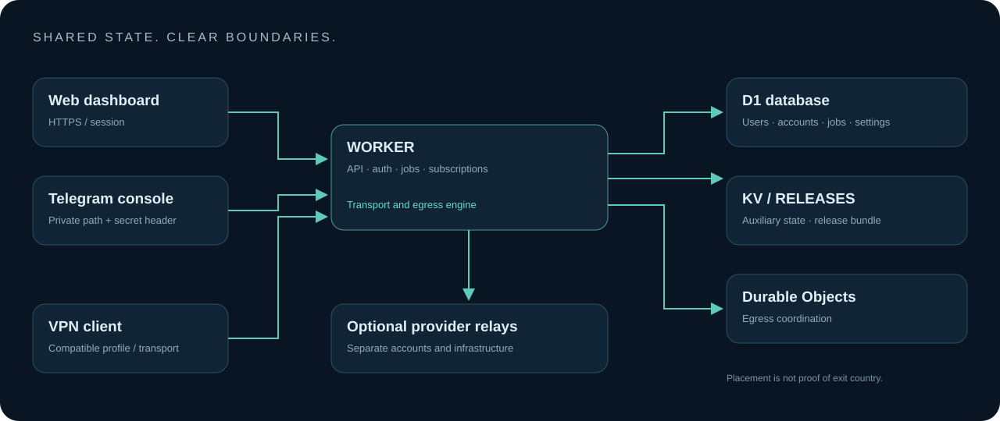

# معماری، کوتاه و روشن

[English](ARCHITECTURE.md)

**وب و تلگرام دو رابط به یک مرکز مدیریت‌اند.** Worker احراز هویت، API، تولید اشتراک، پردازش اتصال و هماهنگی jobها را اجرا می‌کند. HTML پنل داخل همان ماژول جاسازی می‌شود؛ frontend جداگانه لازم نیست.

| منبع | مسئولیت |
|---|---|
| **D1 / DB** | حساب‌ها، کاربران، نشست‌ها، تنظیمات و وضعیت کارهای چندمرحله‌ای |
| **KV** | دادهٔ کمکی و cache؛ بدون تضمین سازگاری آنی |
| **RELEASES** | بستهٔ جاری و نسخه‌های بازگشت برای استقرار و آپدیت نود |
| **EGRESS** | Durable Objectهای هماهنگی خروجی؛ نه سرور عمومی UDP |
| **رلهٔ بیرونی** | زیرساخت اختیاری با حساب، هزینه و محدودیت مستقل |

کاربر و سیاست دسترسی پیش از اتصال خروجی بررسی می‌شوند. ساب‌لینک، تنظیمات را به قالب کلاینت تبدیل می‌کند؛ وجود یک قالب، قابلیت سرور همهٔ پروتکل‌های آن کلاینت را ایجاد نمی‌کند. حساب‌های WARP و MASQUE جدا نگه داشته می‌شوند.

رمز مدیر با PBKDF2 و salt مشتق می‌شود. نشست معمولی در D1 و کوکی HttpOnly/Secure نگهداری می‌شود؛ مسیر محدودِ فقط‌خواندنی برای بعضی خطاهای سهمیه وجود دارد. وب‌هوک تلگرام مسیر خصوصی و هدر معتبر می‌خواهد. نقش مدیر داخل پنل با مالکیت منابع ارائه‌دهنده یکی نیست.

**بعضی جریان‌ها توکن ارائه‌دهنده را در D1 نگه می‌دارند؛ خزانهٔ رمزگذاری‌شدهٔ سراسری در لایهٔ برنامه وجود ندارد.** دسترسی D1 و پشتیبان SQL باید محرمانه باشد.

## ساخت و انتشار

`panel/src/panel.html` رابط قابل‌ویرایش و `panel/src/worker.mjs` بک‌اند تجمیع‌شده است. `panel/build.mjs` آن‌ها را با نسخهٔ `panel/release.json` ترکیب و manifest دارای SHA-256 می‌سازد. این جداسازی مسیر انتشار است، نه ادعای بازنویسی کامل موتور به میکروسرویس.

نسخهٔ قابل‌نمایش از یک منبع می‌آید. شمارهٔ داخلی revision صعودی است تا تغییر نام نسخه، ترتیب آپدیت را خراب نکند. انتشار مرکزی، Worker و `RELEASES/current` را همگام می‌کند؛ آپدیت دستی تلگرام همان بسته را با حفظ bindingها روی نود انتخابی می‌فرستد. ارتقای خودکار همهٔ نودها بدون `OMNI_AUTO_UPGRADE=1` فعال نیست.

پاسخ سلامت، ساخت deployment یا پینگ خوب، جای اتصال واقعی گوشی را نمی‌گیرد. بعضی پروب‌ها از مرورگر و بعضی از لبهٔ Cloudflare اجرا می‌شوند؛ نتایجشان یکسان نیست.
