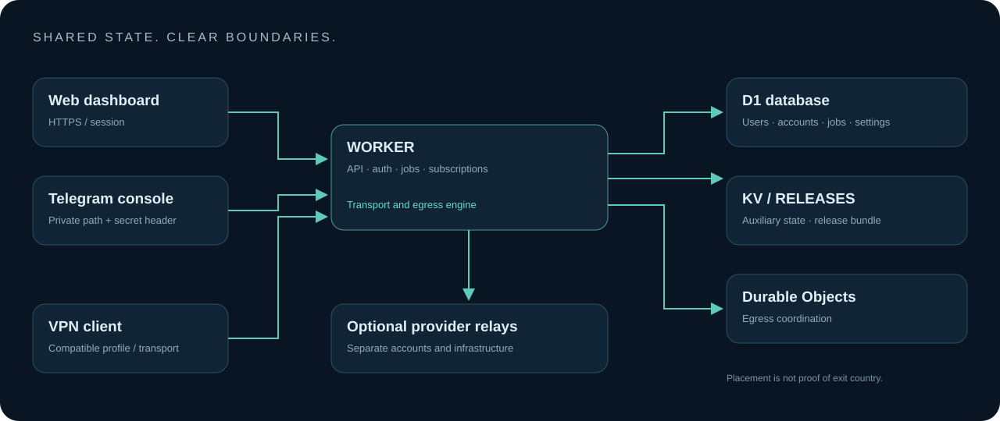

# Architecture

[فارسی](ARCHITECTURE.fa.md)

Web and Telegram are interfaces to a shared Worker control plane. The Worker handles authentication, APIs, subscriptions, transports and provider jobs; its embedded dashboard needs no separate frontend deployment.

- **D1 / DB:** accounts, users, sessions, settings and durable provisioning state.
- **KV:** auxiliary/cache data, with eventual consistency and quotas.
- **RELEASES:** current deployment bundle and private rollback copies.
- **EGRESS:** Durable Object egress coordination, not a general-purpose UDP server.
- **External relays:** optional infrastructure with independent accounts, pricing and limits.

Transport authorization checks users and policy before outbound access. Subscription formats do not create new server protocols. WARP and MASQUE use separate account records.

Admin passwords use salted PBKDF2; normal sessions use D1 and secure HttpOnly cookies. A limited read-only fallback exists for selected quota failures. Telegram requires a private path and verified secret header. Panel roles and provider-resource ownership are separate authority checks.

Some provider workflows retain tokens in D1. There is no application-wide encrypted token vault; database access and SQL exports must be protected.

## Release boundaries

`panel/src/panel.html` is editable UI; `panel/src/worker.mjs` is the preserved bundled backend. `panel/build.mjs` embeds the UI, applies the version in `panel/release.json`, parses JavaScript and emits SHA-256 hashes. This is a separated release pipeline, not a claim of a complete microservice rewrite.

A monotonically increasing revision preserves upgrade ordering. Central publication synchronizes the Worker and `RELEASES/current`; Telegram applies that bundle in-place to a selected node, preserving its bindings. Automatic child rollout requires `OMNI_AUTO_UPGRADE=1`.

Health, deployment readiness and HTTP latency are not proof of a working device tunnel. Browser and edge probes observe different networks.
